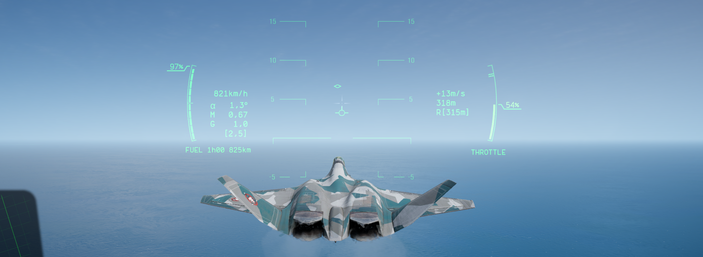
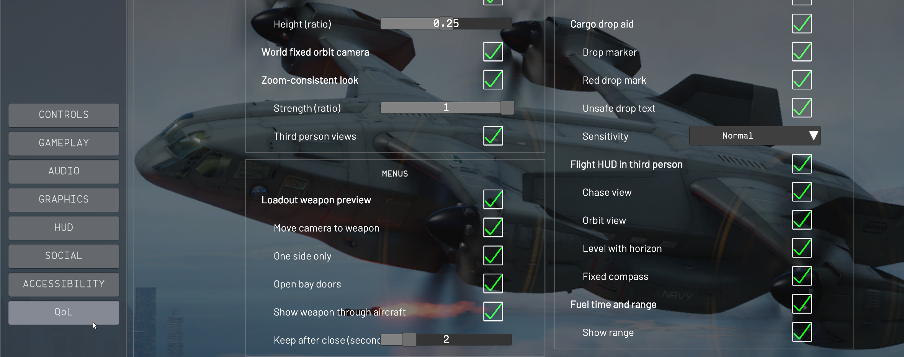
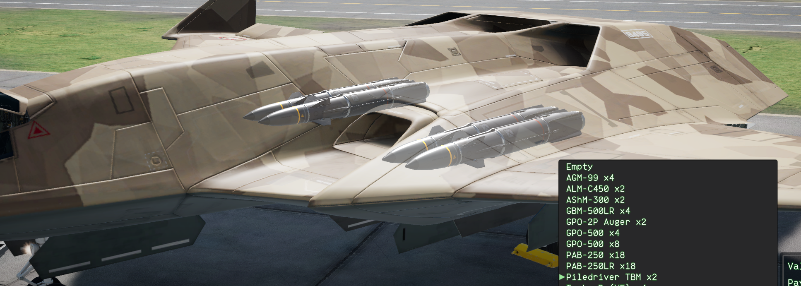

# NeutralQoL

Client side quality of life mod for Nuclear Option.

- Works on any server, modded or not. The mod never touches networking and
  never sends anything an unmodded game would not send.
- Never changes the simulation
- Never shows hidden information and never aims, flies or fires for you.



## Installation

**Manual:**

1. Install if don't have [BepInEx 5.4.x x64](https://github.com/BepInEx/BepInEx/releases)
   into the game folder and start the game once.
2. Download `NeutralQoL.zip` from the
   [latest release](https://github.com/DevHrytsan/NeutralQoL/releases/latest).
3. Unzip it into `BepInEx/plugins/NeutralQoL/` in the game folder.

**(When it will available) With the Nuclear Option Mod Manager (NOMM):** find NeutralQoL in the mod
list and install it. NOMM keeps it up to date.

## Settings

In game: **Settings, QoL tab**. Every feature has its own switch and options
there, and changes apply right away. Turning a feature off restores the
vanilla behaviour without a restart.



The same settings are stored in
`BepInEx/config/com.devhrytsan.neutralqol.cfg`. The mod never writes to the
game's own settings.

## Features

### Menus



| Feature | Default | What it does |
| --- | --- | --- |
| Loadout weapon preview | on | While a hardpoint's weapon list is open in the aircraft selection menu, shows what that hardpoint carries. Each part below can be turned off on its own. |
| Open bay doors | on | Opens the hardpoint's bay doors or cargo ramp so you can see what is loaded inside. |
| Move camera to weapon | on | Frames and zooms in on the hardpoint's weapon. Hold Free Look and move the mouse to turn round it. |
| Show weapon through aircraft | on | Fades in a see-through copy of the weapons, so ones in bays or under the fuselage show from any angle. |

### HUD

| Feature | Default | What it does |
| --- | --- | --- |
| Flight HUD in third person | off | Shows your flight HUD and minimap in the chase and orbit views. |
| Fuel time and range | on | Flight time left at the current fuel burn under the fuel gauge, optionally the range, yellow or red when fuel runs low. |
| Cargo drop aid | on | While cargo is selected: an `[UNSAFE DROP]` warning and a ground marker where it would land, worked out with the game's own parachute physics and wind. |
| Auto Hover reminder | off | Shows `[AUTO HOVER OFF]` when you fly an Auto Hover aircraft slowly near the ground with it switched off. It only reminds you. |

### Camera

| Feature | Default | What it does |
| --- | --- | --- |
| Zoom-consistent look | on | Free look slows down while zoomed in, so a mouse move turns the view by the same share of the screen at every zoom. |
| Raised orbit camera | on | Lifts the orbit camera so the aircraft sits lower on screen and the aim marker shows above it. |
| World fixed orbit camera | on | Keeps the orbit camera pointing the same compass direction when the aircraft turns. |

### Weapons

| Feature | Default | What it does |
| --- | --- | --- |
| Jamming pod as a switch | off | Tap Fire to start jamming and again to stop, instead of holding the button. |
| Open bay doors on weapon select | off | Keeps the selected weapon's bay doors open while it is selected. Only you see it; flight and launch timing are unchanged. |

## Problems

The mod logs one line per feature at startup to `BepInEx/LogOutput.log`:
on, off, or broken with the reason. After a game update a feature may show
as unavailable in the QoL tab while the rest keep working. Please
[open an issue](https://github.com/DevHrytsan/NeutralQoL/issues) with that
log attached.

## Building and contributing

See [CONTRIBUTING.md](CONTRIBUTING.md) for setup, the build commands and the
rules every feature follows. To build a release zip:

```
python tools/package.py --game-version 0.34.1
```

## License

Mozilla Public License 2.0, see [LICENSE](LICENSE).
